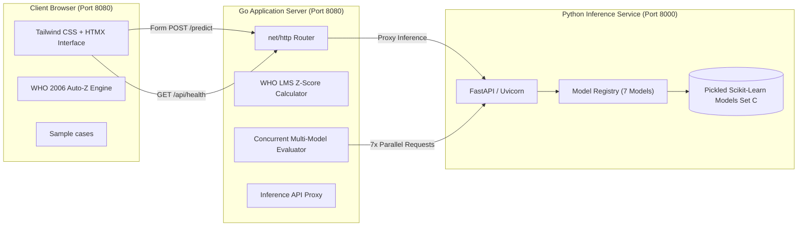

# Child Malnutrition Prediction — Research Prototype

[](https://golang.org)
[](https://python.org)
[](https://fastapi.tiangolo.com)
[](https://tailwindcss.com)
[](https://htmx.org)

> **Intended Use**: This is a research prototype that accompanies a published analysis. It has not been externally validated and must not be used to guide decisions about individual children. A positive result means the model predicts MUAC below 12.5 cm; this must be confirmed by measuring MUAC.

This application is a **Go web frontend** paired with a **FastAPI machine learning inference backend** hosting 7 benchmarked models trained on non-circular machine learning models (internally validated only), **Predictor Set C**.

---

## 📌 Research Background & Non-Circular Methodology

### The Circular Data Leakage Problem
Earlier malnutrition prediction literature attempted to predict composite WHO Z-score categories ($WAZ, HAZ, WHZ$) using predictors derived from the exact same mathematical equations. This circular linkage produced artificial >99% accuracy.

### The Corrected Formulation (Predictor Set C)
- **Target Variable**: Reformulated to a separately measured outcome: **Acute Malnutrition** defined by Mid-Upper Arm Circumference ($\text{MUAC} < 12.5\text{ cm}$).
- **Predictor Set C Features (8 Parameters)**:
  1. `month`: Child age in months (cohort: 6–60 months)
  2. `sex_male`: Biological sex ($1 = \text{Male}, 0 = \text{Female}$)
  3. `area_noakhali`: Study district ($1 = \text{Noakhali}, 0 = \text{Lakshmipur}$)
  4. `weight`: Weight in kilograms (kg)
  5. `height`: Height/length in centimeters (cm)
  6. `waz`: WHO Weight-for-Age Z-score (-6.0 to +6.0)
  7. `haz`: WHO Height-for-Age Z-score (-6.0 to +6.0)
  8. `whz`: WHO Weight-for-Height Z-score (-6.0 to +6.0)
- **Primary Model**: **Logistic Regression** with balanced class weighting ($\text{AUC} = 0.71$), evaluated alongside 6 benchmarked algorithms.

---

## 🤖 7 Benchmarked Machine Learning Models

| Model Key | Algorithm | Primary Model | Notes |
|:---|:---|:---:|:---|
| **`logistic_regression`** | `Pipeline(StandardScaler, LogisticRegression)` | **Yes** | Primary model in the paper. Balanced class weights. Threshold: **0.662**. |
| **`random_forest`** | `RandomForestClassifier(n_estimators=300, max_depth=6)` | No | Ensemble of 300 decision trees with max depth 6. |
| **`gradient_boosting`** | `GradientBoostingClassifier()` | No | Sequential boosting ensemble. |
| **`stacking_ensemble`** | `StackingClassifier(LR + DT + RF)` | No | Meta-ensemble combining three base learners. |
| **`svm_rbf`** | `Pipeline(StandardScaler, SVC)` | No | Support Vector Classifier with RBF kernel and probability estimates. |
| **`mlp`** | `Pipeline(StandardScaler, MLPClassifier)` | No | Feedforward neural network with ReLU activation, hidden layer size (32,). |
| **`decision_tree`** | `DecisionTreeClassifier(max_depth=4)` | No | Single decision tree with max depth 4. |

---

## 🏗 System Architecture



---

## ⚡ Quick Start

### Option 1: Automatic 1-Click Startup (Recommended)

#### On Windows (Batch / Command Prompt):
```bat
start-all.bat
```

#### On Windows (PowerShell):
```powershell
.\start-all.ps1
```

Once launched, your browser will open automatically at **[http://localhost:8080](http://localhost:8080)**.

---

### Option 2: Manual Multi-Terminal Startup

#### Terminal 1: Start Python FastAPI Inference Backend
```bash
cd "..\Malnutrition-Prediction-python-service"
.\venv\Scripts\activate        # Windows
# source venv/bin/activate     # Linux/macOS
pip install -r requirements.txt
python -m uvicorn app.main:app --host 127.0.0.1 --port 8000 --reload
```

#### Terminal 2: Start Go Web Frontend
```bash
cd "Predicting_malnutrition"
go run main.go
```
- Web Application: **[http://localhost:8080](http://localhost:8080)**

---

## 📡 API Endpoints

### Go Web Frontend & Proxy Endpoints (Port 8080)

| Method | Endpoint | Description |
|:---:|:---|:---|
| `GET` | `/` | Serves main interactive research prototype interface |
| `POST` | `/predict` | Primary prediction handler (returns HTML partial for HTMX or JSON) |
| `POST` | `/api/predict` | JSON REST API: Evaluates single model inference |
| `POST` | `/api/predict-all` | JSON REST API: Evaluates all 7 models for comparative evaluation |
| `GET` | `/api/health` | Health probe checking Go frontend and Python backend |
| `GET` | `/api/models` | Registry catalog of all 7 machine learning models |
| `POST` | `/api/estimate-zscores` | Calculates approximate WHO 2006 Standard Z-scores ($WAZ, HAZ, WHZ$) |

---

### Request Payload Example (`POST /api/predict`)
```json
{
  "month": 24.0,
  "sex_male": 1,
  "area_noakhali": 1,
  "weight": 7.5,
  "height": 85.0,
  "waz": -3.5,
  "haz": -1.5,
  "whz": -3.8,
  "model_name": "logistic_regression"
}
```

### Response Example
```json
{
  "model_used": "logistic_regression",
  "model_file": "model_set_c_logistic_regression.pkl",
  "model_type": "Pipeline",
  "prediction": 1,
  "status": "Predicted MUAC < 12.5 cm",
  "risk_probability": 0.7025,
  "threshold": 0.662,
  "model_loaded": true,
  "features_used": [24.0, 1, 1, 7.5, 85.0, -3.5, -1.5, -3.8]
}
```

---

## 📦 Model Training & Source Code

The model files are produced by `export_models.py` in the primary analysis repository:
**[https://github.com/imak2363/child-malnutrition](https://github.com/imak2363/child-malnutrition)**

That repository contains:
- `Malnutrition_Full_Analysis_Revised.ipynb` — full analysis notebook reproducing all manuscript tables and figures
- `export_models.py` — trains the 7 Set C models with Table S4 hyperparameters and exports `.pkl` files and `thresholds.json`

See `../Malnutrition-Prediction-python-service/models/README.md` for the full training procedure and threshold documentation.

---

## 🐳 Docker Deployment

```bash
docker build -t predicting-malnutrition .
docker run -d -p 8080:8080 -e PYTHON_API_URL="http://host.docker.internal:8000" --name malnutrition-app predicting-malnutrition
```

---

## 🧪 Testing

```bash
cd "..\Malnutrition-Prediction-python-service"
python tests\run_tests.py
```

---

## 📄 License
This project is licensed under the MIT License — see the [LICENSE](LICENSE) file for details.
